# Skydock

An autonomous weed-spraying UAV. It flies a lawnmower pattern over a field,
spots weeds with an on-board AI camera, works out where each one is on the ground,
then flies back to each weed, lines itself up directly overhead and sprays it.
Once the pilot flips it into autonomous mode, it needs no input until it heads home.

## The first full autonomous mission

**8 August 2026.** On the left, a phone filming from the ground. On the right, what
the UAV saw, synced to the same clock and rendered from the flight log. It
scans the field, picks out the target, flies to it, homes in and sprays.

[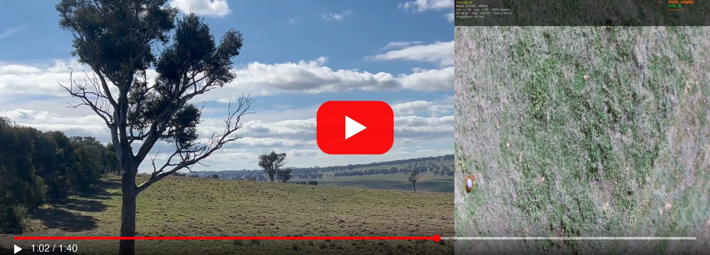](https://youtu.be/gQA05xkfV48)

**[Watch on YouTube](https://youtu.be/gQA05xkfV48)**

## How it works

1. **Scan.** Fly a lawnmower path at 10 m, logging every AI detection with the
   UAV's position and attitude at that instant.
2. **Cluster.** Project each detection from pixels to a GPS point on the ground,
   then group nearby hits into weed locations. A weed needs several independent
   detections before it counts.
3. **Go to** the nearest unsprayed weed.
4. **Home.** Use the live camera to close the last few metres, descending
   until the weed sits directly under the nozzle.
5. **Spray**, mark it done and move to the next one. Return to launch when the
   list is empty.

The pilot can take over at any time from the RC transmitter. A 3-position switch
turns autonomy on or off, and battery and failsafe handling stays with ArduPilot.

The state machine as I designed it:

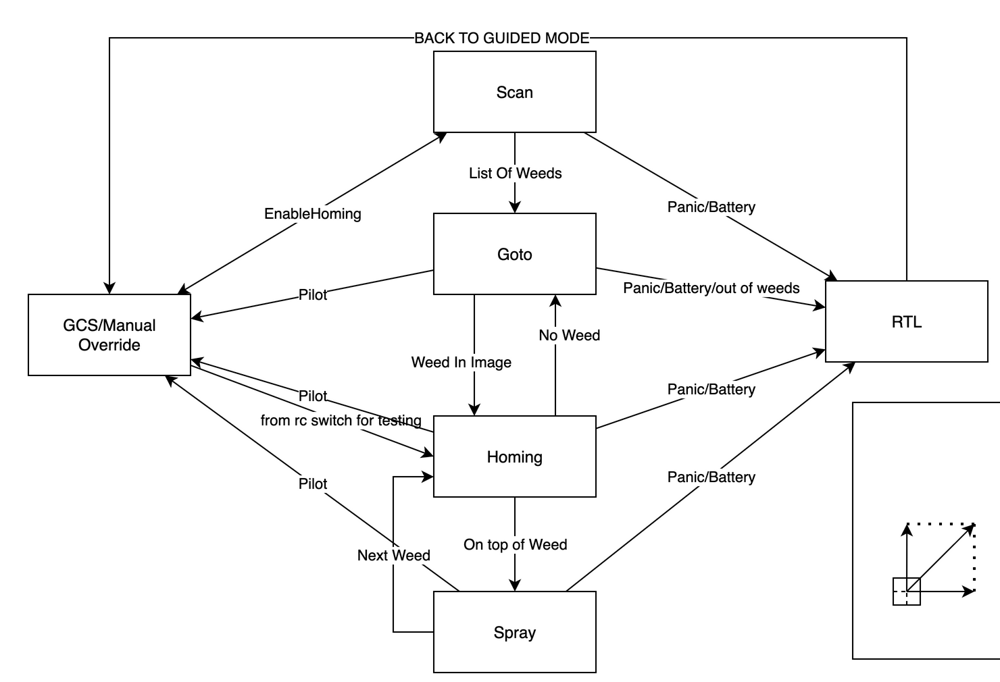

The system: ArduPilot flight controller <-> Raspberry Pi 5 companion computer
(MAVLink) <-> Hailo AI accelerator and camera:

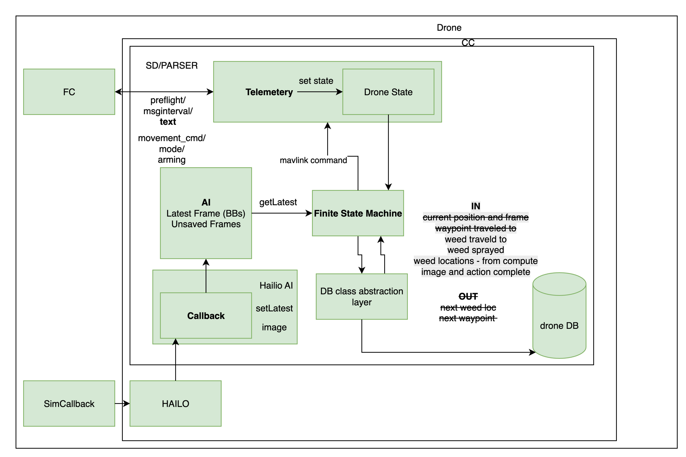

And the homing logic, including the camera-geometry sketch it's built from:

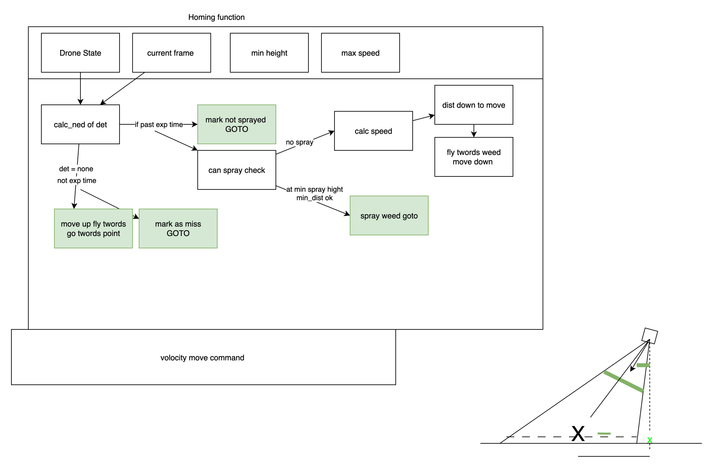

| | |
|---|---|
| Flight controller | ArduPilot Copter |
| Companion computer | Raspberry Pi 5, Python |
| AI | Hailo-8 accelerator + camera, object detection at up to 60 fps |
| Simulation | ArduPilot SITL with a simulated camera, so the same code flies in sim and for real |
| Analysis | Per-flight logs + a web app to replay, compare and render every mission |

## Timeline

### 2025: early airframes
Before this codebase, I was experimenting with airframes, starting with a fixed-wing
VTOL conversion.

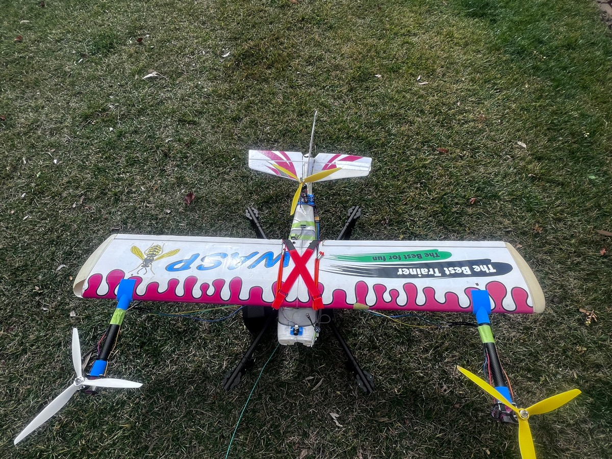

### January 2026: project start
- Repository started. MAVLink link to the flight controller working.
- Hailo AI pipeline running on the Raspberry Pi 5.
- First homing function, tested on the ground.

### February 2026: system design
- Drew up the system architecture and the state machine (diagrams above).
- Built the mission database, the FSM skeleton, a logger and a video stitcher
  for debugging flights.
- Started testing on the final UAV.

### March 2026: the quadcopter build
- Built the quad with the Pi and AI camera on board.
- Built a web UI for browsing flight logs.
- Made the simulator run faster than real time, and started unifying the sim
  and real code paths.

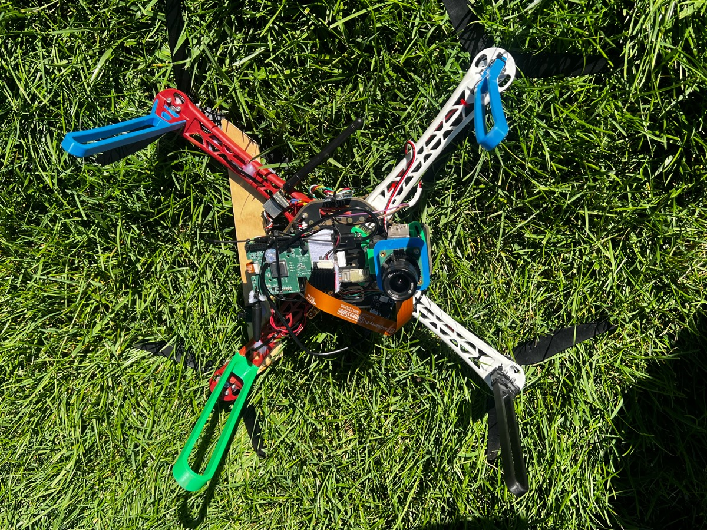 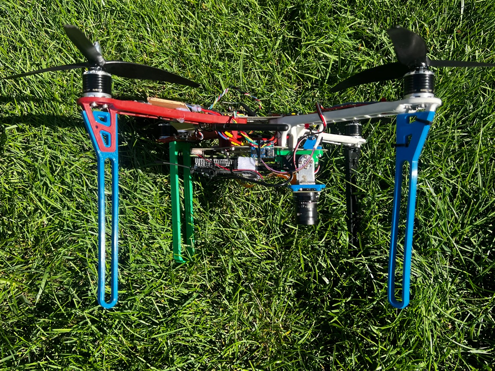

### April 2026: new frame and field testing
- Moved to a new carbon-frame quad.
- Moved from the backyard to an open field, with a ground station (RC transmitter
  plus laptop).
- Lowered the scan height after detections proved unreliable from higher up.
- Sim and real now run through the same code.

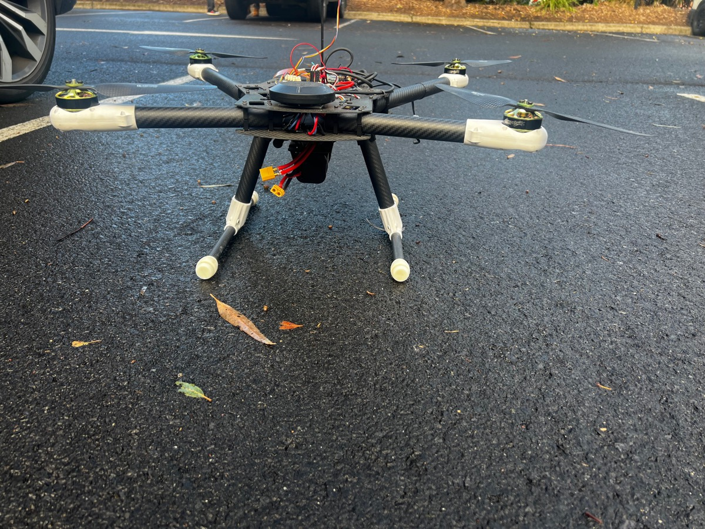 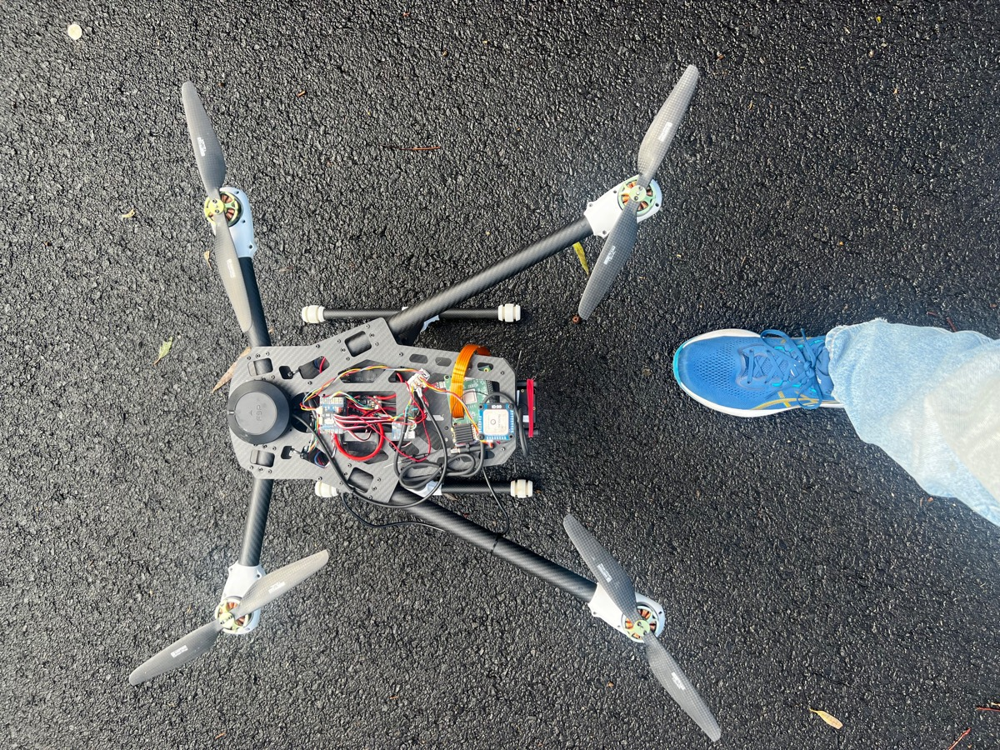

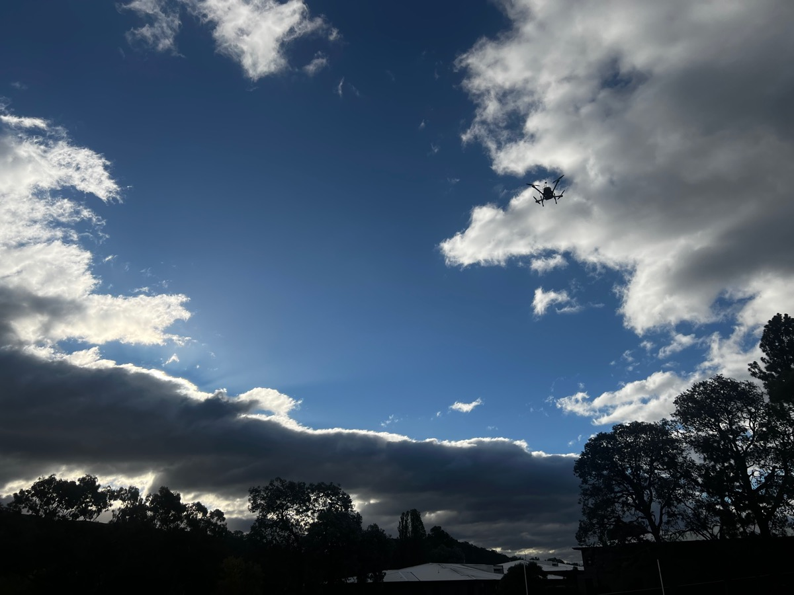 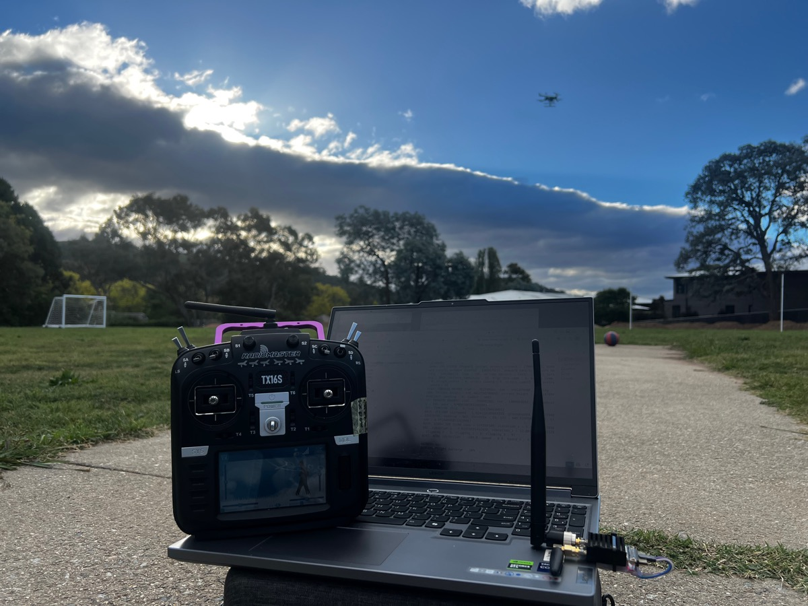

### May 2026: real-world flight data
- Every real flight now logged on the Pi and synced back for analysis.
- Fixes found from real data: waiting for the first attitude message before
  projecting detections, score-based detection picking during homing, and the
  camera pipeline raised to 60 fps.
- Tried a long-range RFD900 radio link to the Pi, then switched to a Wi-Fi
  network because the RFD900 was too slow. No code changes were needed; the
  switch was entirely in how the autopilot link was set up.

### June 2026: better tooling
- Overhauled mission logging into a single versioned format, and added an
  automated test suite.
- The log viewer gained a live ground-control panel.

### July 2026: first successful homing
- Found and fixed the "homing-blind" bug: the real camera resolution never
  reached the projection code, so homing was steering from bad numbers.
- Verified the camera's mounting orientation from pixel motion in flight logs.
- **11 July: first successful homing.** The UAV found the target, flew over
  it, centred itself and sprayed.

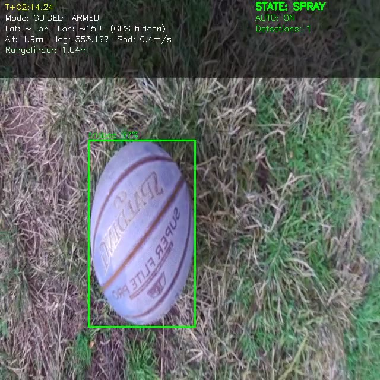

### August 2026: full autonomous missions
- **8 August: first full mission**, scan, go to, home, spray, with no pilot
  input once autonomy was switched on.
  **[Watch it on YouTube](https://youtu.be/gQA05xkfV48)**
- PID control for homing, measured simulator speed, a tool to tune clustering
  constants offline, and CI.

### Next
- A testing ladder from Monte Carlo runs in simulation, to bench tests that
  measure the real detector's miss rate, to constrained flights.
- Then tune each constant against measurements, changing one thing per flight.
- Separate detection models for scanning (high up) and homing (close in).

## Running it

```bash
python main.py --sim          # full mission in ArduPilot SITL
python main.py                # on the UAV
python tools/log_server/app.py   # flight log viewer at http://localhost:5050
python -m pytest              # tests
```

Setup, repository layout, the log format and the test suites are covered in the
**[developer guide](docs/developer_guide.md)**. See also
[architecture](docs/architecture.md) and [testing](docs/testing.md).
